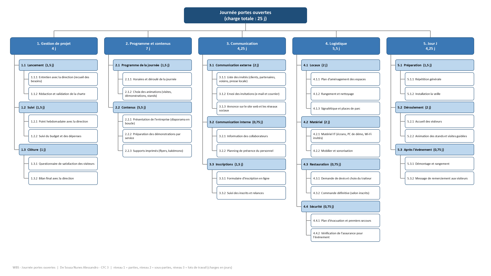
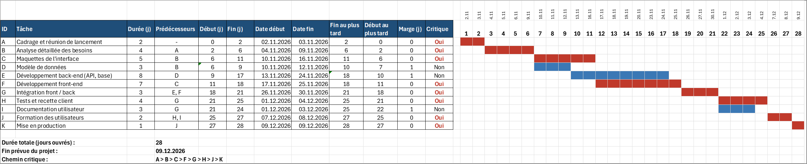
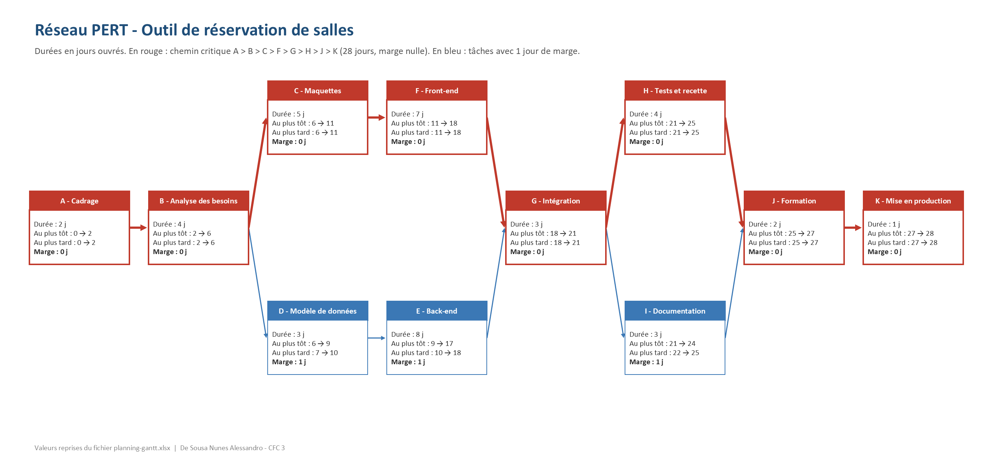
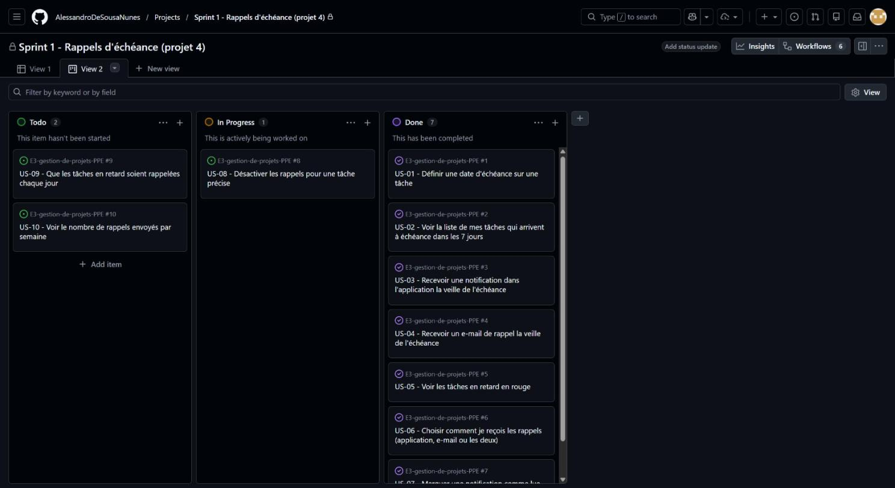

# Rendu PPE – Cours 1 : Techniques de gestion de projets (306)

- **Étudiant :** De Sousa Nunes Alessandro – CFC 3
- **Formateur référent :** Morrad
- **Semaine PPE :** octobre 2026

## Remarque : les 5 projets ont été réalisés

La consigne demande de choisir **un** des 5 projets. J'ai choisi de réaliser **les 5**, car je trouvais les projets trop courts pour remplir une semaine de PPE. Cela m'a permis de pratiquer toutes les techniques vues en cours : charte et WBS, cahier des charges et Gantt, gestion des risques, Scrum et pilotage complet.

## Formateur absent : parties simulées

Certaines étapes demandent une intervention du formateur (entretien de recueil des besoins, validation, aléa injecté en cours de semaine, comité de pilotage). Le formateur n'étant pas présent, j'ai pris pour ces étapes **un cas plausible qu'il aurait pu me donner**. Chaque partie concernée est signalée dans les documents par un encadré rouge « Formateur absent » ou « Simulation ». Les validations et signatures du formateur sont laissées vides.

| Projet | Partie simulée |
|---|---|
| 1 | Réponses à l'entretien de recueil des besoins ; validation remplacée par un auto-contrôle |
| 3 | Scénario choisi (migration de la messagerie, selon l'énoncé) |
| 4 | Sprint simulé, comme demandé par la consigne |
| 5 | Chiffres réels de la semaine, aléa (administrateur malade le J3), comité de pilotage |

## Contenu du rendu

Chaque dossier contient les fichiers de travail (Excel, Word, PowerPoint), **une version PDF de chaque fichier** (lisible directement dans GitHub) et un dossier `captures` avec les captures d'écran.

**Présentation :** [`presentation-5-projets.pdf`](presentation-5-projets.pdf) (12 slides, version modifiable : `presentation-5-projets.pptx`) – résumé des 5 projets pour la présentation orale.

### Projet 1 – Charte et découpage d'un mini-projet interne
- `charte-de-projet.docx` – charte (besoins, objectifs, périmètre, parties prenantes, WBS, jalons, contrôle)
- `wbs-et-jalons.xlsx` – WBS sur 3 niveaux avec charges calculées, frise des jalons
- `wbs-diagramme.pptx` – diagramme en arbre du WBS (54 éléments), construit à partir du fichier Excel
- `parties-prenantes-et-raci.xlsx` – matrice pouvoir / intérêt des parties prenantes (stratégie calculée) et matrice RACI (contrôle automatique d'un seul « A » par activité)

### Projet 2 – Cahier des charges et planning Gantt
- `cahier-des-charges.docx` – cahier des charges, estimations, note sur le chemin critique, vérifications
- `planning-gantt.xlsx` – Gantt avec dépendances, marges et chemin critique calculés par formules

- `reseau-pert.pptx` – réseau PERT des tâches avec dates au plus tôt / au plus tard et marges

### Projet 3 – Analyse et gestion des risques d'un projet IT
- `analyse-des-risques.docx` – méthode, registre, matrice, plans de mitigation des 3 risques critiques
- `registre-des-risques.xlsx` – registre (10 risques), matrice probabilité / impact, échelles

### Projet 4 – Sprint Scrum simulé
- `sprint-revue-retrospective.docx` – user stories, sprint planning, daily, burndown, revue, rétrospective
- `backlog-et-burndown.xlsx` – product backlog priorisé et burndown chart
- **Tableau Scrum sur GitHub** : les 10 user stories sont aussi des [Issues de ce dépôt](https://github.com/AlessandroDeSousaNunes/E3-gestion-de-projets-PPE/issues?q=label%3A%22user+story%22) (critères d'acceptation, priorité MoSCoW, points, jalon « Sprint 1 ») et sont suivies dans un [tableau GitHub Projects](https://github.com/users/AlessandroDeSousaNunes/projects/3) (Todo / In Progress / Done). Les 7 stories terminées sont fermées, US-08 est restée « In Progress » (non terminée), US-09 et US-10 sont dans le backlog.

### Projet 5 – Pilotage complet d'un mini-projet
- `1-plan-de-projet-initial.docx` – plan initial (objectifs, équipe, planning, budget, risques, suivi)
- `2-rapports-avancement-COPIL.docx` – rapports d'avancement n°1 (J2) et n°2 (J4)
- `3-fiche-gestion-alea.docx` – analyse de l'aléa, options et décision
- `4-bilan-cloture-REX.docx` – bilan de clôture et retour d'expérience
- `plan-et-suivi-du-projet.xlsx` – budget, planning, tableau de bord de suivi, risques, matrice RACI

## Auto-évaluation

[`auto-evaluation.pdf`](auto-evaluation.pdf) (version Excel : `auto-evaluation.xlsx`) reprend, pour chaque projet, les critères et pondérations officiels des fiches, indique où chaque critère est couvert dans le rendu et note les points faibles. Les taux sont mon estimation personnelle ; la note officielle reste celle du formateur.
